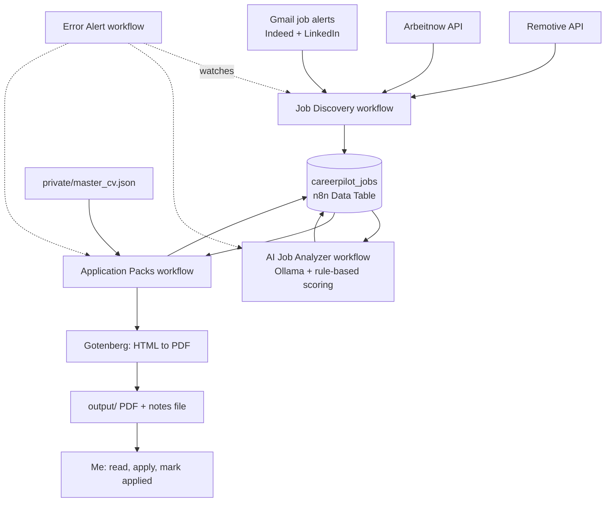

# CareerPilot AI

A local, privacy-first job-hunting assistant built with **n8n**, a **local LLM (Ollama)** and **Docker**.
It finds relevant jobs, scores them, and prepares a tailored one-page CV and a cover message for each good match.
**It never applies for anything. You review every pack and press the button yourself.**

> Status: personal project, working end to end on my own machine. Built to learn automation, self-hosting and responsible AI use.


## What it does

1. **Collects jobs** from Remotive and Arbeitnow (public APIs) and from my own Indeed and LinkedIn job-alert emails (read through the Gmail API with a read-only scope).
2. **Cleans and de-duplicates** every listing into one table.
3. **Scores each job** for my target roles (DevOps/cloud, Linux/infrastructure, IT support, WordPress) and flags problems such as seniority, on-site outside my country, or remote roles restricted to other regions.
4. **Builds an application pack** for each job worth a look: a one-page PDF CV, a short cover message, and a notes file with the apply link.
5. **Tracks status** in the same table, and alerts me when a scheduled run fails.

## Design decisions

- **Human in the loop.** Nothing is sent or submitted automatically. The output is a folder of files I read and use myself.
- **The LLM extracts, rules decide.** The small local model only reads postings (skills, summary). Scores, categories, seniority and red flags come from plain code, so results are repeatable and a bad model answer cannot change a decision.
- **No invented CV content.** My CV facts live in one private `master_cv.json`. The system only *selects and orders* lines from that file. It never writes new claims. The cover message is built from a template plus lines from the same file.
- **Untrusted job text.** Postings are treated as data, never as instructions (some postings try to instruct AI tools).
- **Privacy.** Everything runs locally. Credentials stay in n8n, the personal CV file is mounted read-only, and personal files and generated CVs are git-ignored.
- **No scraping.** LinkedIn and Indeed are used only through alert emails sent to my own inbox.

## Architecture



## Workflows

| Workflow | Purpose |
|---|---|
| `CareerPilot - Job Discovery` | Fetches and parses jobs from all sources and upserts them without duplicates |
| `CareerPilot - AI Job Analyzer` | Sends unscored jobs to Ollama, then computes score, category, flags and recommendation in code |
| `CareerPilot - Application Packs` | Selects CV lines, builds the PDF and message, saves files, updates status |
| `CareerPilot - CV Tailor` | Single-job version used for testing |
| `CareerPilot Error Alert` | Sends an alert when a scheduled workflow fails |

Exported JSON files are in [`workflows/`](workflows/).

## Tech stack

n8n (self-hosted) · Docker Compose · Ollama (`qwen2.5:3b`) · Gotenberg · Gmail API (OAuth2, read-only) · JavaScript (n8n Code nodes) · n8n Data Tables

## Setup

Requirements: Docker Desktop (or Docker Engine), about 8 GB of RAM free for containers, a Gmail account with job alerts set up.

1. **Clone** the repo and copy the example files:
   ```bash
   cp .env.example .env              # then set a real N8N_ENCRYPTION_KEY
   mkdir -p private output
   cp master_cv.example.json private/master_cv.json   # then edit with YOUR real facts
   ```
   Generate a key with `openssl rand -hex 32` and keep a private backup of it. Without it, saved n8n credentials cannot be decrypted.
2. **Start the stack:**
   ```bash
   docker compose up -d
   docker compose exec ollama ollama pull qwen2.5:3b
   ```
3. **Open n8n** at `http://localhost:5678` (bound to localhost only) and create an owner account.
4. **Create the Data Table** `careerpilot_jobs` with the columns listed below.
5. **Create credentials:** Gmail OAuth2 with the read-only scope `https://www.googleapis.com/auth/gmail.readonly`, and a webhook or other channel for error alerts.
6. **Import** the workflows from `workflows/`, attach your credentials, and check the node settings (Data Table, file paths, Gmail query).
7. **Set up job alerts** on Indeed and LinkedIn for the roles and locations you want. They must arrive in the Gmail account you connected.
8. Run **Job Discovery**, then **AI Job Analyzer**, then **Application Packs**, and look in `output/`.

### Data Table columns

`source, external_id, title, company, location, job_url, description, category, job_type, salary, posted_at, is_remote, matched_keywords, discovered_at, status, ai_analyzed, relevance_score, job_category, seniority, required_skills, nice_to_have_skills, ai_reason, red_flags, ai_recommendation, pack_cv_file, pack_subject, pack_message, pack_notes, packed_at`

Booleans: `is_remote`, `ai_analyzed`. Number: `relevance_score`. Everything else is a string.

### Safe commands

Never run `docker compose down -v`. It deletes the volumes that hold your n8n data and the downloaded model.

## Limitations

- Runs on a personal computer, so schedules only run while it is on and Docker is running.
- Google OAuth apps in testing mode can require re-authorisation roughly weekly.
- LinkedIn alert emails contain no job description, so those jobs are scored from the title only.
- The local 3B model is slow on CPU and makes mistakes, which is why scoring is rule-based.
- Region and seniority checks are heuristics. Always read the real posting.

## Roadmap

- Optional Gmail draft (draft-only permission) for postings that include a contact email
- Cross-source de-duplication by company and title
- Sample data and a demo mode so the project can be tried without personal inboxes
- Pin container image versions

## Responsible use

This project is for managing my own job search. It does not scrape job sites, log in to them, or submit applications. Respect the terms of every service you connect.

## License

MIT (add a `LICENSE` file before publishing)
